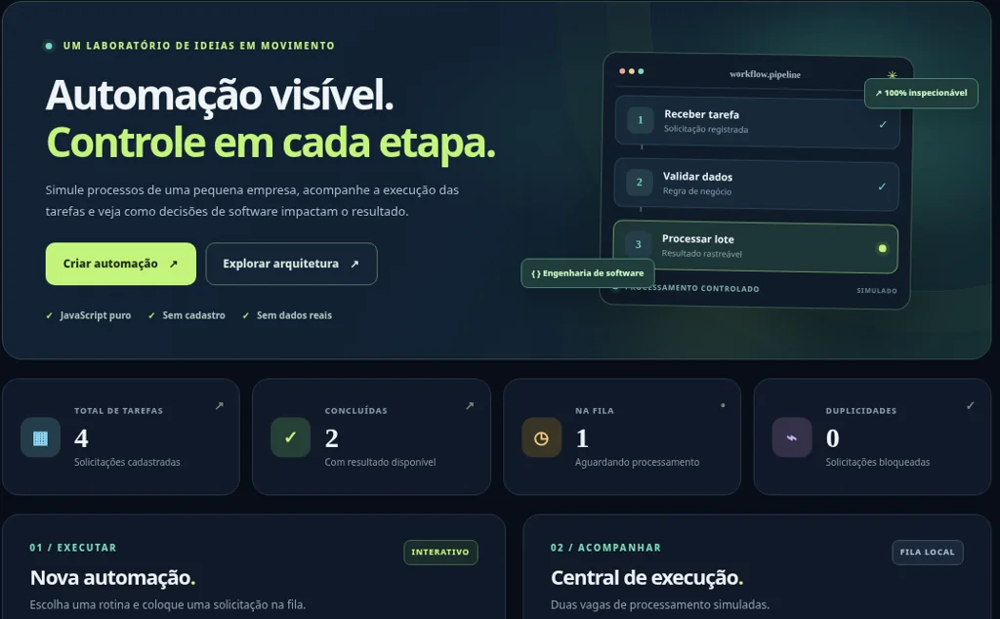

# AutomationLab — engenharia de software aplicada à automação

Desenvolvi o **AutomationLab** para explorar, em uma aplicação que pode ser utilizada e examinada, problemas comuns em sistemas de automação: validar dados, controlar o estado de tarefas, evitar operações repetidas e lidar com falhas de forma rastreável.

O cenário é uma pequena operação comercial **inteiramente fictícia**. A proposta é tornar visível a lógica por trás da interface, sem depender de dados, código ou regras de sistemas corporativos.

**[Abrir demonstração interativa](https://leocarvalho090.github.io/portfolio-dev/apps/automationlab/)** · **[Conhecer meu portfólio](https://leocarvalho090.github.io/portfolio-dev/)** · **[Meu LinkedIn](https://www.linkedin.com/in/leonardo-carvalho-131464449)**



## O projeto em funcionamento

A aplicação oferece três rotinas baseadas em dados de demonstração:

- **Auditoria de estoque:** calcula a disponibilidade considerando unidades reservadas e identifica itens abaixo do limite mínimo.
- **Validação de pedidos:** verifica SKUs, quantidades e saldo disponível, indicando pedidos que exigem revisão.
- **Relatório de vendas:** consolida lançamentos e permite exportar um CSV compatível com planilhas em português.

Essas regras **são executadas em JavaScript**. Já a fila com duas posições de processamento e os tempos de execução são **simulações realizadas no navegador**, não tarefas concorrentes em um servidor.

## Decisões de implementação

| Aspecto | Como foi tratado |
| --- | --- |
| Separação de responsabilidades | `assets/engine.mjs` concentra regras e estados; `assets/app.js` cuida da interface, eventos e armazenamento local. |
| Identificação de tarefas | Cada solicitação possui um ID e uma chave formada por tipo e referência normalizada. |
| Prevenção de duplicidades | O estado local rejeita uma nova tarefa com a mesma chave e registra a tentativa no histórico. |
| Tratamento de falhas | É possível provocar uma falha na primeira execução e reenfileirar a tarefa preservando seu identificador. |
| Recuperação após recarga | Tarefas que estavam em execução passam ao estado de interrompidas e exigem nova ação do usuário. |
| Rastreabilidade | Mudanças relevantes geram registros de auditoria, exportáveis em JSON. |
| Persistência | O `localStorage` mantém o estado demonstrativo naquele navegador. |

O objetivo dessas escolhas foi favorecer **clareza, previsibilidade e facilidade de teste**. A deduplicação é local e não equivale a garantias transacionais em um ambiente com vários usuários.

## Qualidade e testes

O motor possui **nove testes automatizados** com o módulo nativo de testes do Node.js. Eles verificam cálculos e validações, geração de CSV, regras de duplicidade, identificação de tarefas, falhas controladas e retomada do estado.

O repositório também contém um fluxo do **GitHub Actions** que executa `npm test` em pushes e pull requests. A configuração do fluxo não deve ser confundida com uma garantia de implantação ou disponibilidade em produção.

## Estrutura

```text
index.html                  Interface da aplicação
assets/
  app.js                    Interações, fila visual e persistência local
  engine.mjs                Regras de negócio e transições de estado
  styles.css                Layout e responsividade
  favicon.svg
tests/
  engine.test.mjs           Testes automatizados
.github/workflows/
  tests.yml                 Execução dos testes no GitHub Actions
package.json
```

### Executar localmente

O projeto não exige framework, banco remoto ou instalação de pacotes para a interface.

```bash
git clone https://github.com/LeoCarvalho090/automationlab.git
cd automationlab
python3 -m http.server 8000 --bind 127.0.0.1
```

Acesse `http://localhost:8000/`. Para executar os testes, com **Node.js 20 ou superior** instalado:

```bash
npm test
```

O uso de um servidor HTTP local é recomendado porque a interface importa módulos ES.

## Escopo e limitações

O AutomationLab é um **projeto de estudo autoral**, não um sistema comercial em operação. Não possui autenticação, permissões de usuário, banco compartilhado, filas em backend, integrações externas nem sincronização entre dispositivos. Os dados são fictícios e as operações não efetivam vendas, reservas ou mensagens.

Uma evolução para uso empresarial exigiria arquitetura de servidor, persistência confiável, controle de acesso, idempotência transacional, backups, observabilidade e requisitos de privacidade e segurança adequados.

Este código foi desenvolvido como projeto independente. **Não contém código, documentos ou informações internas de empregadores ou clientes.**

---

**Leonardo Carvalho** · Desenvolvimento web e automação de processos  
[Portfólio](https://leocarvalho090.github.io/portfolio-dev/) · [LinkedIn](https://www.linkedin.com/in/leonardo-carvalho-131464449) · [GitHub](https://github.com/LeoCarvalho090)
